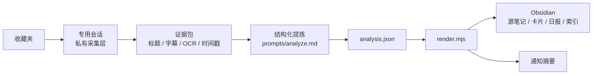

# 抖音收藏简报 · Douyin Favorites Brief

> **作品集展示版** · 把“收藏夹吃灰”做成一条每天可跑的本地信息流水线。

`收藏 → 证据 → 提炼 → 日报 → 行动`

[简体中文](README.md) | [English](README.en.md)

> **这不是公开爬虫，也不是“一键复现”包。** 这个仓库公开的是产品定义、架构、提示词、渲染器和合成示例；采集/登录层依赖个人登录态与平台页面，不包含在公开仓库。

---

## 先看结果

一条收藏视频，经过“证据提取 → 结构化判断 → 日报排序”，最终变成一张能直接决策的卡片：

| 字段 | 回答的问题 |
| --- | --- |
| 讲了什么 | 这条视频的核心观点/方法是什么 |
| 钩子 | 第几秒给出反常识结论或关键演示 |
| 值不值 | 值得完整看 / 只看前半 / 看个乐 / 跳过 |
| 能抄什么 | 1–3 条动词开头的可执行动作 |
| 要不要跟进 | 要 / 不要 / 以后再说，以及理由 |

- [知识卡示例](examples/sample-card.md)
- [收藏日报示例](examples/sample-daily.md)
- [分析 JSON 示例](examples/sample-analysis.json)

示例均为合成内容，不对应真实视频或真实账号。

## 问题

收藏动作很便宜，回看很贵。

刷到一条讲工具、方法或案例的视频，点收藏只需要一秒；真正坐下来回看，需要重新找到它、判断值不值得看、再从口播里提取可执行的动作。结果是收藏夹越来越长，真正进入工作和知识库的内容越来越少。

现有方案通常要求再装一个 App、再登录一个账号、再订阅一个服务。但这个场景需要的能力——定时、浏览器、文件读写、模型、通知——本地环境已经具备。缺的不是另一个客户端，而是一条**可维护、失败可定位、结果能落到 Obsidian** 的处理流水线。

## 我做了什么

这个项目从需求到运行由我独立完成，AI 作为实现与运维的协作工具。

### 1. 产品定义

先把“收藏夹吃灰”拆成可验收的流程、字段、状态和失败分支，而不是直接写爬虫：

- 输入：收藏夹里的新视频；
- 中间状态：采集中 → 已下载 → 已抽帧/OCR → 已分析 → 已渲染 → 已推送；
- 输出：知识卡、每日日报、索引、通知摘要；
- 失败：登录失效、单条下载失败、抽帧超时、模型漏条、渲染校验失败。

完整产品定义见 [docs/product.md](docs/product.md)；想自己跑一遍看 [docs/operations.md](docs/operations.md)。

### 2. 实现

- **采集层**：Node.js + Playwright，专用 Chrome 会话，按 `aweme_id` 去重，下载视频、抽帧、OCR。
- **分析层**：不把模型写死在脚本里；由宿主按 [prompts/analyze.md](prompts/analyze.md) 生成严格 JSON，模型可替换、输出可人工检查。
- **渲染层**：Node.js 把 JSON 渲染成 Obsidian 源笔记、知识卡、日报和索引；本仓库包含这一层和可运行 demo。
- **通知层**：宿主定时任务的最终回复即日报摘要，由本地通知通道推送；不推送中间工具过程。
- **运维**：每一步可单独重跑；失败进入日报的“失败 / 待处理”区，不阻塞其他条目。

### 3. 公开边界

| 层 | 是否公开 | 原因 |
| --- | --- | --- |
| 产品定义、案例、架构、决策 | 是 | 展示问题拆解与取舍 |
| 提示词、JSON 契约、渲染器 | 是 | 可审阅、可运行、无登录态 |
| 合成示例、demo | 是 | 不依赖真实账号与网络 |
| 采集器、登录器、OCR 编译产物 | 否 | 依赖个人会话、平台页面和本机环境 |
| Cookie、原始视频、真实卡片、日志 | 否 | 隐私与版权边界 |

这也是一个明确的产品判断：**完整链路的价值不等于把采集器包装成公共产品。** 公开展示“怎么定义、怎么判断、怎么渲染、怎么失败”，私有保留“怎么登录、怎么采集”。

## 30 秒运行 demo

不需要登录、不需要网络、不需要安装依赖；只需要 Node.js >= 20.11，不用 `npm install`：

```bash
git clone https://github.com/Ryankiinovo/douyin-favorites-brief.git
cd douyin-favorites-brief
npm run demo
```

输出会写到 `demo/out/抖音收藏/`，包含：

```text
demo/out/抖音收藏/
├── 10 Sources/2026/10/0000000000000000000.md
├── 20 Cards/2026-10-22-0000000000000000000.md
├── 30 Daily/2026-10-22-收藏日报.md
└── 索引.md
```

渲染器只读 JSON/Markdown，不调用模型、不访问网络。demo 的输入在 [demo/fixtures](demo/fixtures)，说明见 [demo/README.md](demo/README.md)。

## 工作流（完整系统）



公开仓库覆盖 `C → F` 的契约与渲染；`A → C` 的采集和登录留在私有运行环境。

## 关键取舍

| 选择 | 放弃什么 | 换来什么 |
| --- | --- | --- |
| 专用 Chrome + 持久会话 | 多一个窗口、依赖本机 Chrome | 登录态跨天复用，定时任务可无人值守 |
| OCR 优先，不接 ASR | 口播为主的内容效果有限 | 不引入额外服务/费用/隐私评估，MVP 能跑 |
| JSON + Markdown，不上数据库 | 复杂查询和并发能力 | 可直接检查、手工修复、无迁移负担 |
| 模型与采集解耦 | 不能“一条命令全自动” | 模型可替换，失败可单独重跑 |
| 公开渲染层，私有采集层 | 不能承诺一键复现 | 展示产品判断，同时守住账号与平台边界 |

## 结果

| 里程碑 | 状态 | 证据 |
| --- | --- | --- |
| M1 单条闭环 | 已完成 | 一条视频生成源笔记、知识卡、日报记录 |
| M2 批量与去重 | 已完成 `--limit 10` | 成功 9 条、失败 1 条（ffmpeg 抽帧超时）；同日重复运行按日合并 |
| M3 每日定时 + 通知 | 已落地 | 每日 08:00（Asia/Shanghai）任务；最终回复为日报摘要 |
| M4 历史回填 | 未开始 | 先保证每日增量稳定，再决定是否回填最近 90 天 |

失败样本没有被隐藏：它进入日报的“失败 / 待处理”区。这比“成功率 100%”的截图更能说明系统能被维护。

## 这个项目证明了什么

- 能把一个模糊的“收藏夹吃灰”拆成可验收的流程、字段和失败分支；
- 能把模型能力放进一条可运维的链路，而不是做一个一次性 demo；
- 能在隐私、平台边界和可用性之间做取舍；
- 能让 AI 参与实现，但把产品判断、验收和边界留在人这边。

适合 **B 端产品、AI 应用、FDE / 行业解决方案** 方向的读者快速判断：我如何定义问题、如何做取舍、如何把失败当成一等公民。

## 目录

```text
.
├── README.md / README.en.md
├── LICENSE
├── docs/
│   ├── product.md          # 产品定义（公开版）
│   ├── architecture.md     # 完整系统与公开层
│   ├── case-study.md       # 作品集叙事
│   ├── decisions.md        # 关键决策
│   ├── privacy.md          # 公开边界与威胁模型
│   └── operations.md       # 运行手册：环境、配置、登录、日常运行、故障处理
├── prompts/analyze.md      # 结构化提炼提示词
├── examples/               # 合成示例
├── demo/                   # 无登录、无网络的渲染 demo
├── scripts/
│   ├── render.mjs          # Obsidian 渲染器
│   └── lib.mjs             # 配置与文件工具
└── tests/README.md         # 手工验收清单
```

## 隐私与边界

- 公开仓库不包含 Cookie、sessionid、登录二维码、原始视频、真实 OCR 原文、真实知识卡或本机路径。
- 采集层不公开，不提供“自动点赞/关注/评论/发布”等功能，不绕过验证码或平台风控。
- 示例均为合成内容；如果引用真实内容，应先获得必要授权。
- 更完整的边界见 [docs/privacy.md](docs/privacy.md)。

## License

MIT。见 [LICENSE](LICENSE)。

---

如果这个项目对你有帮助，欢迎在 GitHub 上提 issue 讨论产品判断、渲染器或隐私边界；不要用它提交真实账号数据。
